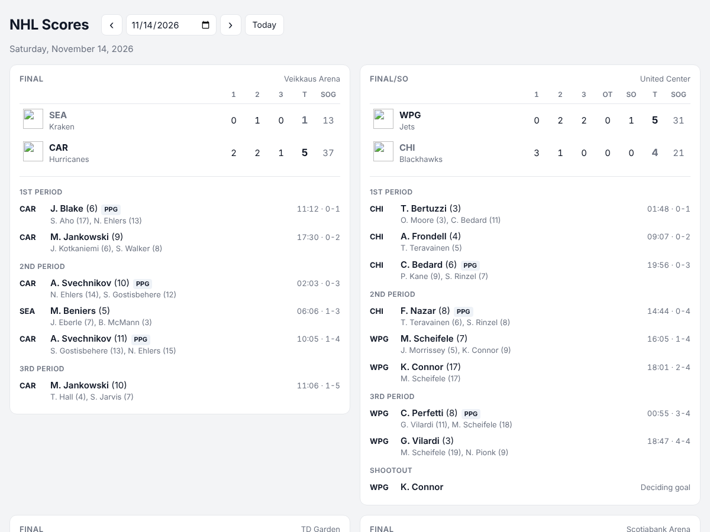

# hockey-visual

Per-player NHL game scorecards that will roll up into season and career scores.



The first piece is a scores page. Pick a date and see every game's linescore (goals by
period, OT/SO when played, total, shots) and the goal scorers with assists.
Live games refresh on their own (the hosted site updates about every 10 minutes).

## Box scores

Each live or finished game on the scores page has a **Box score** button that opens
`game.html?id=<gameId>`. The main design is **Game Story** (`story`): the Broadcast look
with the Analytics and Scorecards data, in five sections you can jump between:

1. **Story**: an automatic headline (comebacks, shutouts, OT/SO, the winning goal, who drove play), scoring plays, three stars, team stats.
2. **Momentum**: shot-attempt flow with goals marked, key numbers, period-by-period results.
3. **Shots**: shot map filtered by team and period.
4. **Players**: player of the game plus a scorecard per player (3-10 rating and the Game Score parts behind it).
5. **Box score**: goaltending and a heat-mapped skater table.

The earlier designs (`broadcast`, `analytics`, `scorecards`, `classic`) stay in the switcher
at the top (keys 1-5, or `&design=<name>`) for comparison.

Data: `src/gameDetail.js` combines the `boxscore`, `landing`, `right-rail` and
`play-by-play` endpoints into `data/games/<gameId>.json`, including every shot's
rink location and a Game Score per player (on-ice impact uses +/- until shift data is added).

## Hosting (GitHub Pages)

| Site | Branch | URL |
| --- | --- | --- |
| Production | `main` | https://xdionx.github.io/hockey-visual/ |
| Test | `develop` | https://xdionx.github.io/hockey-visual/test/ |

GitHub Pages only serves static files, and the NHL API can't be called from a
browser (it sends no CORS headers). So the GitHub Action in
`.github/workflows/publish.yml`:

1. runs `scripts/update-data.js`, which saves each date's scores as
   `data/scores/<date>.json` (plus `data/latest.json` for "today"),
2. keeps those files on the `scores-data` branch so only the last 2 days and
   the next 2 weeks are re-fetched each run,
3. publishes `main` at the site root and `develop` under `/test/`.

It runs on every push to `main` or `develop`, every 10 minutes from noon to
3 AM Eastern (GitHub can delay scheduled runs by a few minutes), and on demand
from the Actions tab. Live scores on the hosted site are therefore up to about
10 minutes behind.

One-time setup: in the repo's **Settings → Pages**, set **Source** to
**GitHub Actions**.

## Live updates (Cloudflare Worker)

GitHub's scheduler can't run more often than every 5 minutes, so live games come
from a small Cloudflare Worker (`worker/index.js`). It answers the same paths as
`data/` (`latest.json`, `scores/<date>.json`, `games/<id>.json`), fetches the NHL API
on demand and caches each answer at the edge:

| Game | Cached for |
| --- | --- |
| Live | 5 seconds (pages re-poll every 5 seconds) |
| Not started | 60 seconds |
| Finished, today or yesterday | 1 hour |
| Finished, 2+ days old | 30 days |

Pages use it when `public/config.js` has `LIVE_API` set (the publish workflow writes it
from the `LIVE_API_URL` repository variable) and fall back to the saved `data/` files
if it fails. Polling pauses while the tab is hidden.

Setup: add repository secrets `CLOUDFLARE_API_TOKEN` (the "Edit Cloudflare Workers"
template) and `CLOUDFLARE_ACCOUNT_ID`, run **Deploy live Worker** from the Actions tab,
then set the `LIVE_API_URL` variable to the Worker URL it prints.

## Run it locally

Needs Node 18 or newer, and nothing else (no `npm install`).

```
npm start          # http://localhost:3000   (PORT=4000 npm start to change)
npm test           # unit tests for the data layer
```

Locally, `server.js` answers the same `data/...` URLs live from the NHL API,
so you don't need to run the data script. Open
`http://localhost:3000/?date=2026-11-14` to jump straight to a date.

## Layout

| Path | What it is |
| --- | --- |
| `src/nhlApi.js` | NHL API client with a small cache and 429 back-off. Already has `getBoxscore`, `getPlayByPlay`, `getRightRail`, `getPlayer` for the scorecard work. |
| `src/normalize.js` | Pure functions that turn raw API games into `{ status, away, home, linescore, goals }`. Reusable by later scorecard / season / career code. |
| `scripts/update-data.js` | Saves score files for the hosted site. |
| `server.js` | Local dev server. Zero dependencies. |
| `src/gameDetail.js` | Pure function that builds one game's box score (players, shots, game scores). |
| `public/` | Scores page (`index.html`, `app.js`, `styles.css`) and box score page (`game.html`, `game/`: one file per design). |
| `test/` | `node --test` tests against a saved real-game fixture (regulation, OT, shootout). |

## NHL API notes

- `GET /v1/score/{date}` (or `/v1/score/now`) returns every game for a date,
  with each goal (period, time, scorer, assists, strength). The linescore is
  built from that list; the shootout column shows the deciding goal only
  (1-0), matching nhl.com and the official `right-rail` linescore.
- `gameState`: `FUT`/`PRE` upcoming, `LIVE`/`CRIT` in progress, `FINAL`/`OFF` done.
- Behind a corporate/agent HTTPS proxy, run with `NODE_USE_ENV_PROXY=1` (Node 22.21+).
